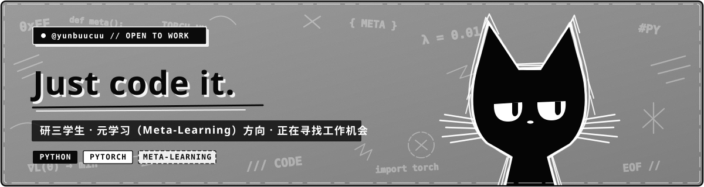

<!-- ==================== 顶部定制 Nord 深/浅自适应横幅 ==================== -->

  <picture>
    <source media="(prefers-color-scheme: dark)" srcset="./assets/banner-dark.svg">
    <source media="(prefers-color-scheme: light)" srcset="./assets/banner-light.svg">
    
  </picture>

 

<!-- ==================== 社交与联系方式徽章（Nord flat-square） ==================== -->

  <a href="mailto:238471007@qq.com">
    <picture>
      <source media="(prefers-color-scheme: dark)" srcset="https://img.shields.io/badge/Email-238471007@qq.com-5E81AC?style=flat-square&labelColor=2E3440&logo=maildotru&logoColor=88C0D0">
      <source media="(prefers-color-scheme: light)" srcset="https://img.shields.io/badge/Email-238471007@qq.com-5E81AC?style=flat-square&labelColor=D8DEE9&logo=maildotru&logoColor=2E3440">
      
    </picture>
  </a>
  <a href="https://github.com/yunbuucuu">
    <picture>
      <source media="(prefers-color-scheme: dark)" srcset="https://img.shields.io/badge/GitHub-@yunbuucuu-4C566A?style=flat-square&labelColor=2E3440&logo=github&logoColor=ECEFF4">
      <source media="(prefers-color-scheme: light)" srcset="https://img.shields.io/badge/GitHub-@yunbuucuu-81A1C1?style=flat-square&labelColor=D8DEE9&logo=github&logoColor=2E3440">
      
    </picture>
  </a>
  <picture>
    <source media="(prefers-color-scheme: dark)" srcset="https://img.shields.io/badge/%E7%8A%B6%E6%80%81-%E6%AD%A3%E5%9C%A8%E6%B1%82%E8%81%8C-A3BE8C?style=flat-square&labelColor=2E3440">
    <source media="(prefers-color-scheme: light)" srcset="https://img.shields.io/badge/%E7%8A%B6%E6%80%81-%E6%AD%A3%E5%9C%A8%E6%B1%82%E8%81%8C-A3BE8C?style=flat-square&labelColor=D8DEE9">
    
  </picture>
  <!-- 后续开通个人博客或 X 后，取消下方注释并替换链接即可生效
  <a href="https://your-blog.example.com">
    <picture>
      <source media="(prefers-color-scheme: dark)" srcset="https://img.shields.io/badge/Blog-%E4%B8%AA%E4%BA%BA%E5%8D%9A%E5%AE%A2-5E81AC?style=flat-square&labelColor=2E3440&logo=rss&logoColor=88C0D0">
      <source media="(prefers-color-scheme: light)" srcset="https://img.shields.io/badge/Blog-%E4%B8%AA%E4%BA%BA%E5%8D%9A%E5%AE%A2-5E81AC?style=flat-square&labelColor=D8DEE9&logo=rss&logoColor=2E3440">
      
    </picture>
  </a>
  <a href="https://x.com/your_handle">
    <picture>
      <source media="(prefers-color-scheme: dark)" srcset="https://img.shields.io/badge/X-@your__handle-4C566A?style=flat-square&labelColor=2E3440&logo=x&logoColor=ECEFF4">
      <source media="(prefers-color-scheme: light)" srcset="https://img.shields.io/badge/X-@your__handle-81A1C1?style=flat-square&labelColor=D8DEE9&logo=x&logoColor=2E3440">
      
    </picture>
  </a>
  -->

  <picture>
    <source media="(prefers-color-scheme: dark)" srcset="./assets/divider-dark.svg">
    <source media="(prefers-color-scheme: light)" srcset="./assets/divider-light.svg">
    
  </picture>

## 关于我 · About Me

> *“code is everything”* — 你好，欢迎光临我的主页！

- 🎓 **当前身份**：研三在读学生
- 🧠 **研究方向**：元学习（Meta-Learning）
- 💻 **核心技术**：Python、PyTorch
- 💼 **目前状态**：正在寻找工作机会，欢迎交流与内推
- 📫 **联系邮箱**：[238471007@qq.com](mailto:238471007@qq.com)

  <picture>
    <source media="(prefers-color-scheme: dark)" srcset="./assets/divider-dark.svg">
    <source media="(prefers-color-scheme: light)" srcset="./assets/divider-light.svg">
    
  </picture>

## 技术栈 · Tech Stack

| 分类 | 工具与技术 |
| :--- | :--- |
| **编程语言** | <picture><source media="(prefers-color-scheme: dark)" srcset="https://img.shields.io/badge/Python-3B4252?style=flat-square&logo=python&logoColor=88C0D0"><source media="(prefers-color-scheme: light)" srcset="https://img.shields.io/badge/Python-E5E9F0?style=flat-square&logo=python&logoColor=5E81AC"></picture> |
| **深度学习框架** | <picture><source media="(prefers-color-scheme: dark)" srcset="https://img.shields.io/badge/PyTorch-3B4252?style=flat-square&logo=pytorch&logoColor=88C0D0"><source media="(prefers-color-scheme: light)" srcset="https://img.shields.io/badge/PyTorch-E5E9F0?style=flat-square&logo=pytorch&logoColor=5E81AC"></picture> |
| **研究方向** | <picture><source media="(prefers-color-scheme: dark)" srcset="https://img.shields.io/badge/Meta--Learning-%E5%85%83%E5%AD%A6%E4%B9%A0-5E81AC?style=flat-square&labelColor=2E3440"><source media="(prefers-color-scheme: light)" srcset="https://img.shields.io/badge/Meta--Learning-%E5%85%83%E5%AD%A6%E4%B9%A0-5E81AC?style=flat-square&labelColor=D8DEE9"></picture> |

<!-- 常用扩展徽章参考（后续需要时可直接复制粘贴到上表对应行）：
  NumPy:   https://img.shields.io/badge/NumPy-3B4252?style=flat-square&logo=numpy&logoColor=88C0D0
  CUDA:    https://img.shields.io/badge/CUDA-3B4252?style=flat-square&logo=nvidia&logoColor=88C0D0
  Linux:   https://img.shields.io/badge/Linux-3B4252?style=flat-square&logo=linux&logoColor=88C0D0
  Git:     https://img.shields.io/badge/Git-3B4252?style=flat-square&logo=git&logoColor=88C0D0
  Docker:  https://img.shields.io/badge/Docker-3B4252?style=flat-square&logo=docker&logoColor=88C0D0
  LaTeX:   https://img.shields.io/badge/LaTeX-3B4252?style=flat-square&logo=latex&logoColor=88C0D0
-->

  <picture>
    <source media="(prefers-color-scheme: dark)" srcset="./assets/divider-dark.svg">
    <source media="(prefers-color-scheme: light)" srcset="./assets/divider-light.svg">
    
  </picture>

## 精选项目 · Featured Projects

> 项目仓库正在整理与开源筹备中，欢迎持续关注或查看我的 [全部仓库](https://github.com/yunbuucuu?tab=repositories)。

<table>
  <tr>
    <td width="50%" valign="top">
      <h3><a href="https://github.com/yunbuucuu?tab=repositories">元学习研究与实验代码</a></h3>
      
围绕元学习（Meta-Learning）方向的模型复现、实验脚本与研究笔记，后续将逐步整理并开源。

      

        
        
        
      

    </td>
    <td width="50%" valign="top">
      <h3><a href="https://github.com/yunbuucuu?tab=repositories">工程实践与开源工具</a></h3>
      
日常深度学习训练工具链、代码模板与求职实战项目，敬请期待。

      

        
        
      

    </td>
  </tr>
</table>

<!-- 当你有正式公开项目时，可按下方 2×2 卡片模板替换上方表格：
<table>
  <tr>
    <td width="50%" valign="top">
      <h3><a href="https://github.com/yunbuucuu/REPO_1">项目名称 1</a></h3>
      
用一句话介绍这个项目解决什么问题、核心亮点或实验效果。

      

        
        
        
      

    </td>
    <td width="50%" valign="top">
      <h3><a href="https://github.com/yunbuucuu/REPO_2">项目名称 2</a></h3>
      
用一句话介绍这个项目解决什么问题、核心亮点或实验效果。

      

        
        
      

    </td>
  </tr>
</table>
-->

  <picture>
    <source media="(prefers-color-scheme: dark)" srcset="./assets/divider-dark.svg">
    <source media="(prefers-color-scheme: light)" srcset="./assets/divider-light.svg">
    
  </picture>

## GitHub 数据概览 · Stats

  <picture>
    <source media="(prefers-color-scheme: dark)" srcset="https://github-readme-stats.vercel.app/api?username=yunbuucuu&show_icons=true&locale=cn&bg_color=2e3440&title_color=88c0d0&text_color=d8dee9&icon_color=81a1c1&border_color=434c5e&border_radius=8">
    <source media="(prefers-color-scheme: light)" srcset="https://github-readme-stats.vercel.app/api?username=yunbuucuu&show_icons=true&locale=cn&bg_color=eceff4&title_color=5e81ac&text_color=2e3440&icon_color=81a1c1&border_color=d8dee9&border_radius=8">
    
  </picture>
  &nbsp;
  <picture>
    <source media="(prefers-color-scheme: dark)" srcset="https://github-readme-stats.vercel.app/api/top-langs/?username=yunbuucuu&layout=compact&locale=cn&bg_color=2e3440&title_color=88c0d0&text_color=d8dee9&border_color=434c5e&border_radius=8">
    <source media="(prefers-color-scheme: light)" srcset="https://github-readme-stats.vercel.app/api/top-langs/?username=yunbuucuu&layout=compact&locale=cn&bg_color=eceff4&title_color=5e81ac&text_color=2e3440&border_color=d8dee9&border_radius=8">
    
  </picture>

  <picture>
    <source media="(prefers-color-scheme: dark)" srcset="https://streak-stats.demolab.com?user=yunbuucuu&locale=zh_Hans&background=2E3440&border=434C5E&stroke=434C5E&ring=88C0D0&fire=8FBCBB&currStreakNum=ECEFF4&sideNums=ECEFF4&currStreakLabel=88C0D0&sideLabels=81A1C1&dates=D8DEE9&border_radius=8">
    <source media="(prefers-color-scheme: light)" srcset="https://streak-stats.demolab.com?user=yunbuucuu&locale=zh_Hans&background=ECEFF4&border=D8DEE9&stroke=D8DEE9&ring=5E81AC&fire=81A1C1&currStreakNum=2E3440&sideNums=2E3440&currStreakLabel=5E81AC&sideLabels=4C566A&dates=4C566A&border_radius=8">
    
  </picture>

  <picture>
    <source media="(prefers-color-scheme: dark)" srcset="./assets/divider-dark.svg">
    <source media="(prefers-color-scheme: light)" srcset="./assets/divider-light.svg">
    
  </picture>

## 贡献贪吃蛇 · Contribution Snake

  <picture>
    <source media="(prefers-color-scheme: dark)" srcset="https://raw.githubusercontent.com/yunbuucuu/yunbuucuu/output/github-contribution-grid-snake-dark.svg">
    <source media="(prefers-color-scheme: light)" srcset="https://raw.githubusercontent.com/yunbuucuu/yunbuucuu/output/github-contribution-grid-snake.svg">
    
  </picture>

 

<!-- ==================== 底部定制 Nord 深/浅自适应页脚 ==================== -->

  <picture>
    <source media="(prefers-color-scheme: dark)" srcset="./assets/footer-dark.svg">
    <source media="(prefers-color-scheme: light)" srcset="./assets/footer-light.svg">
    
  </picture>

